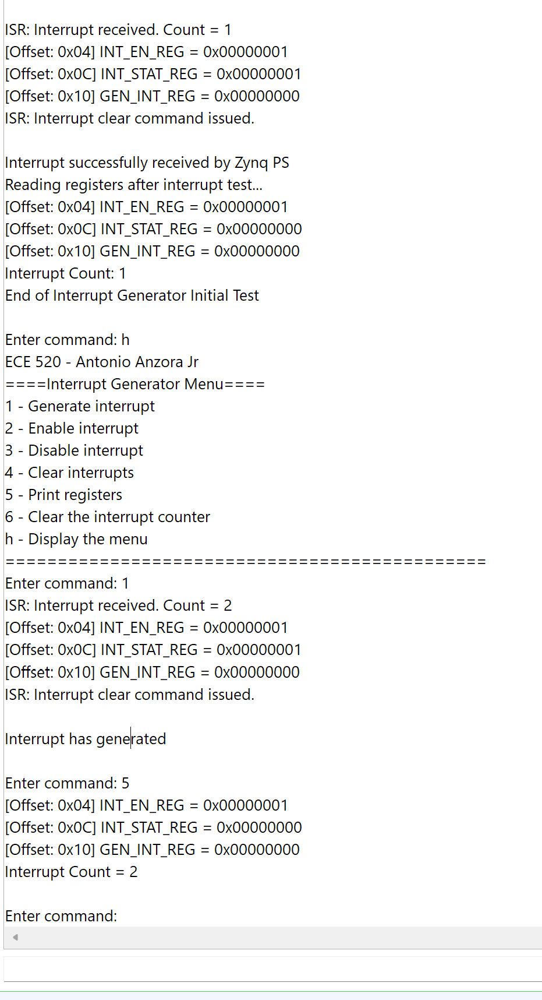
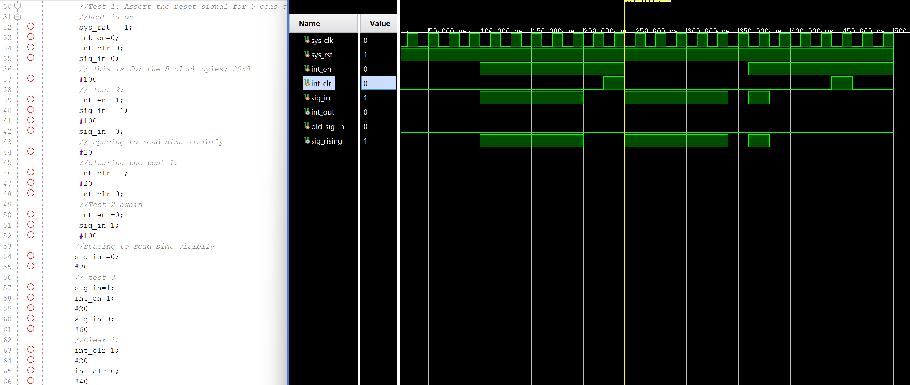
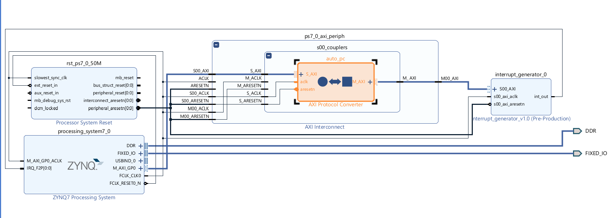

# Lab 5 – Interrupt Generator
**Antonio Anzora Jr. | ECE 520 | CSUN**

## Overview
Building an interrupt module integrated with a custom AXI4-Lite peripheral on the Zynq PS/PL.

## Design Summary
The interrupt generator module was designed in Vivado 2023.1 to detect a rising edge input event and produce a level-triggered interrupt signal. After verifying correct behavior in simulation, the module was packaged as a custom AXI4-Lite IP and added to a block design targeting the Zynq SoC. A Vitis C application was written to test generating, enabling, disabling, and clearing interrupts via a serial terminal menu, with an ISR that increments a counter on each interrupt received.

## Verification and Results

  
*Vitis serial terminal output showing ISR firing and interrupt count incrementing*

  
*Vivado simulation waveform for the interrupt generator testbench*

  
*AXI4-Lite block design with interrupt generator IP and Zynq PS*

## Known Issues / Limitations
During simulation of the packaged IP, an error occurred due to a missing library assignment. Running the following command in the Tcl console resolved it:
```tcl
set_property library xil_defaultlib [get_files]
```

## References
- ece520L_fall26_lab5_interrupt_generator.pdf